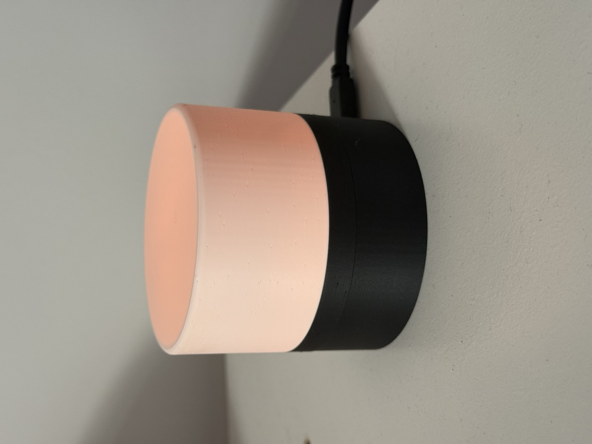

# 🌙 Veilleuse Dexcom — lampe de glycémie autonome

Une veilleuse imprimée en 3D qui affiche en continu la glycémie d'un capteur
**Dexcom G7** par un simple code couleur. Un coup d'œil suffit, même de loin
et en pleine nuit, pour connaître son état — sans sortir le téléphone.

> ⚠️ **Avertissement médical** : c'est un outil de **confort** uniquement.
> Les alarmes de l'application Dexcom officielle restent la seule référence
> médicale. Cette lampe peut afficher un état « périmé » ou « erreur »
> (panne WiFi, API indisponible…) et ne remplace aucun dispositif d'alerte.

> 📄 Genèse et décisions de conception : voir [CONTEXT.md](CONTEXT.md).

🖨️ **Le boîtier est sur MakerWorld** (profil d'impression prêt pour Bambu Lab) :
[makerworld.com/en/models/3097564-veilleuse-dexcom](https://makerworld.com/en/models/3097564-veilleuse-dexcom#profileId-3491186)

## Le projet en deux parties

| Partie | Où | Rôle |
|---|---|---|
| **Veilleuse ESP8266** | [`firmware/`](firmware/) | La lampe : autonome, parle directement à l'API Dexcom Share en HTTPS, pilote un anneau de LED adressables. Aucun serveur requis. |
| **Boîtier 3D** | [`hardware/`](hardware/) | STL prêts à imprimer + scripts Fusion 360 paramétriques (berceau à clips pour la carte, diffuseur à baïonnette). |
| **Dashboard web** (bonus) | branche [`web-dashboard`](https://github.com/didux123/veilleuse-dexcom/tree/web-dashboard) | Petit serveur Node/Express qui affiche la glycémie et son historique 24 h dans le navigateur. Indépendant de la lampe. |

## La veilleuse



### Code couleur

| Lumière | Signification |
|---|---|
| 🟢 Vert doux fixe | Dans la plage (70–180 mg/dL) |
| 🟠 Orange fixe | Hyperglycémie (> 180 mg/dL) |
| 🟠🔄 Gyrophare orange | Hyper sévère (> 300 mg/dL) : 6 LED tournantes — du mouvement, pas plus de lumière |
| 🔴 **Rouge pulsé pleine puissance** | **Hypoglycémie** (ignore le mode nuit) |
| ⚪ Blanc doux fixe | Pas de données fiables (périmées > 15 min, WiFi ou Dexcom injoignable) |
| 🟣 Violet respirant | Mode configuration WiFi |
| 🔴🔵 Rouge/bleu alterné | Identifiants Dexcom refusés |

Jamais de « faux vert » : si la lampe ne sait pas, elle le montre.

### Fonctionnalités

- **Autonome** : l'ESP8266 fait l'authentification Dexcom Share (3 étapes),
  le poll toutes les 60 s, et gère sa session proprement (un seul retry,
  jamais de martèlement de l'API).
- **Portail captif WiFi** : sans réseau connu, la lampe émet `Veilleuse-Dexcom`
  → on configure le WiFi depuis un téléphone. **Multi-réseaux** : chaque
  réseau rejoint est mémorisé (jusqu'à 10), la lampe est nomade.
- **Mode nuit** : luminosité réduite de 22 h à 7 h (heure de Paris,
  été/hiver automatique) — la couleur reste lisible sans éclairer la
  chambre. L'alarme hypo reste à pleine puissance.
- **Mise à jour OTA** : reflashage par WiFi (`veilleuse.local`), avec barre
  de progression sur l'anneau LED.
- Backoff exponentiel sur erreur réseau, détection de fraîcheur par NTP.

### Matériel (~10 €)

- Wemos **D1 mini** (ESP8266)
- Ruban LED adressable **SK6812 / WS2812B** 5 V, 60 LED/m — 12 LED
- Chargeur USB 5 V ≥ 1 A + câble
- Boîtier : 2 pièces imprimées en 3D ([`hardware/`](hardware/))

Câblage : `5V→5V`, `GND→G`, `DIN→D1` (GPIO5). Détails dans
[`firmware/README.md`](firmware/README.md).

### Démarrage rapide

```bash
cd firmware
cp include/secrets.h.example include/secrets.h   # remplir ses identifiants
pio run -t upload                                # premier flash par USB
pio run -e d1_mini_ota -t upload                 # les suivants par WiFi
```

## Le dashboard web (optionnel)

Un petit serveur Node/Express avec UI (valeur géante, graphe 24 h, seuils
réglables) vit sur la branche
[**`web-dashboard`**](https://github.com/didux123/veilleuse-dexcom/tree/web-dashboard)
avec sa propre documentation. Totalement indépendant de la lampe.

## Prérequis côté Dexcom

- Le **partage doit être activé** dans l'app Dexcom G7, avec **au moins un
  follower** invité (sinon l'API Share ne renvoie rien).
- Utiliser les identifiants du **compte qui publie** (l'app G7), pas d'un
  follower.

## Notes sur l'API Dexcom Share

API non officielle (celle des apps Dexcom, documentée par les communautés
[pydexcom](https://github.com/gagebenne/pydexcom) et
[Nightscout](https://github.com/nightscout) — merci à elles). Dexcom peut la
modifier sans préavis. Points d'implémentation : région Europe `shareous1`,
session en RAM, **un seul retry** sur session expirée et jamais de boucle
d'authentification (risque de blocage du compte).

## Licence

[MIT](LICENSE). Fait avec ❤️ et un peu de pancréas artificiel.
